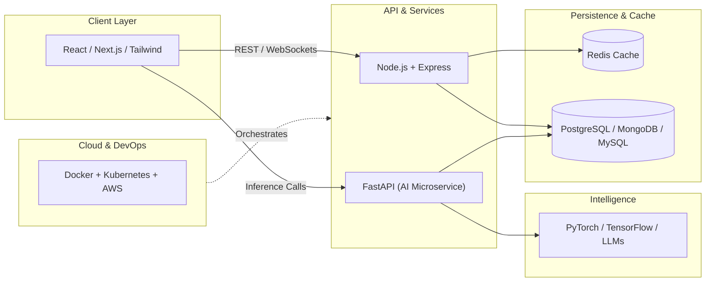

<!-- Animated Header Banner -->
<div align="center">
  
</div>

<!-- Animated Typing Subheader -->
<div align="center">
  <a href="https://github.com/RMukherjee007">
    
  </a>
</div>

<br/>

<!-- Quick Navigation & Social Pill Bar -->
<div align="center">
  <a href="https://www.linkedin.com/in/raghav-mukherjee/">
    
  </a>
  <a href="https://x.com/RMukherjee2005">
    
  </a>
  <a href="mailto:mukherjeeraghav05@gmail.com">
    
  </a>
  
</div>

---

##  `whoami` — Engineering Profile

```yaml
name: Raghav Mukherjee
role: Full-Stack Developer & AI/ML Enthusiast
focus:
  - Designing high-throughput, low-latency backend microservices
  - Crafting responsive, modern frontend interfaces (React / Next.js)
  - Integrating intelligent AI/ML models into real-world production apps
fundamentals: [Data Structures & Algorithms, System Design, DBMS, OS, Computer Networks]
status: "Always building, shipping, and learning 🚀"
```

---

##  Interactive Tech Stack & Arsenal

<div align="center">
<table>
  <tr>
    <td align="center" width="33%">
      <h4> Core Languages</h4>
      
      <br/><sub><code>C</code> • <code>C++</code> • <code>Python</code> • <code>JS</code> • <code>TS</code></sub>
    </td>
    <td align="center" width="33%">
      <h4> Frontend & UI</h4>
      
      <br/><sub><code>React</code> • <code>Next.js</code> • <code>Tailwind</code> • <code>Redux</code></sub>
    </td>
    <td align="center" width="33%">
      <h4> Backend & APIs</h4>
      
      <br/><sub><code>Node.js</code> • <code>Express</code> • <code>FastAPI</code> • <code>REST/GraphQL</code></sub>
    </td>
  </tr>
  <tr>
    <td align="center" width="33%">
      <h4> Databases & Caching</h4>
      
      <br/><sub><code>PostgreSQL</code> • <code>MySQL</code> • <code>MongoDB</code> • <code>Redis</code></sub>
    </td>
    <td align="center" width="33%">
      <h4> AI / Machine Learning</h4>
      
      <br/><sub><code>PyTorch</code> • <code>TensorFlow</code> • <code>Scikit-Learn</code> • <code>LLMs</code></sub>
    </td>
    <td align="center" width="33%">
      <h4> DevOps & Infrastructure</h4>
      
      <br/><sub><code>AWS</code> • <code>Docker</code> • <code>K8s</code> • <code>CI/CD</code> • <code>Linux</code></sub>
    </td>
  </tr>
</table>
</div>

<!-- Interactive Expandable Architecture View -->
<details>
<summary><b> Click to Interact: How My Tech Stack Fits Together (System Architecture)</b></summary>
<br/>

> *Tip: Hover over the diagram below to use GitHub's interactive zoom & pan controls!*



</details>

<details>
<summary><b> Click to Expand: Core Computer Science Competencies</b></summary>
<br/>

<div align="center">
  
  
  
  
  
</div>

</details>

---

##  Live GitHub Telemetry

<div align="center">
  <!-- Overall Profile Summary Card -->
  <a href="https://github.com/RMukherjee007">
    
  </a>
</div>

<div align="center">
  <!-- Reliable Top Languages & Streak Stats -->
  <a href="https://github.com/RMukherjee007">
    
  </a>
  <a href="https://github.com/RMukherjee007">
    
  </a>
  <a href="https://github.com/RMukherjee007">
    
  </a>
</div>

<br/>

<!-- Contribution Graph Section -->
<div align="center">
  <h4> Contribution Activity Graph</h4>
  <a href="https://github.com/RMukherjee007">
    
  </a>
</div>

<details>
<summary><b> Click to view Classic GitHub Contribution Calendar</b></summary>
<br/>
<div align="center">
  
</div>
</details>

---

<!-- Animated Footer -->
<div align="center">
  
</div>
